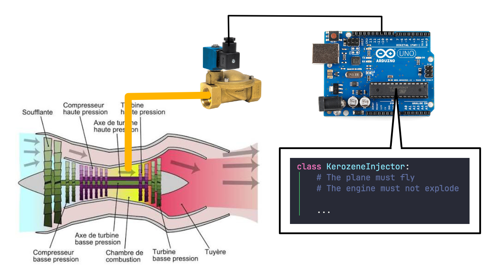

## Moteur d'avion

{.third2}

## Turbo réacteur


## Injection



## Vacances

- Imaginez que vous montiez dans cet avion

{.third2}

## L'ingénieur

- Alors que :

{.third2}

## Responsabilité

- Vous êtes **responsable** des solutions que vous concevez

- **Aucune IA** ne prendra cette responsabilité à votre place

- Vous devez **maitriser** votre code [juste comprendre ne suffit pas]{.small}

## Deux usages, deux situations

- Pour apprendre — votre situation aujourd'hui

  - Vous ne savez pas encore résoudre seul le problème.
  - Vous demandez des **explications**, des **indices** ou des **exercices**
    similaires.
  - L'objectif principal est **votre progression**.
  - **L'IA ne doit pas vous priver de l'effort qui vous fait apprendre.**

- Pour développer — situation d'un développeur

  - Le développeur comprend le besoin et sait évaluer une solution.
  - Il peut demander une **proposition** de code, un test ou une relecture.
  - Il **guide** l'outil, intègre les changements et **vérifie** le résultat.
  - L'objectif est de produire un logiciel **utile, maintenable et correct**.

## Ce que l'IA ne sait pas garantir

- Une réponse **plausible** n'est pas forcément **vraie**.
- Le code peut sembler correct et échouer sur un **cas limite**.
- L'IA peut inventer des choses ou mal interpréter la question.
- Le modèle ne connaît pas forcément les consignes, votre cours ni votre
  environnement.
- L'IA aura toujours l'air confiante de ce qu'elle avance.

**Règle :** traitez chaque réponse comme une **proposition** à examiner, pas
comme une vérité.

<!-- ## Des outils gratuits, avec prudence -->
<!---->
<!-- - Utilisez un service grand public proposant un accès gratuit : par exemple -->
<!--   ChatGPT, Microsoft Copilot, Google Gemini ou Claude, selon les offres -->
<!--   disponibles dans votre région. -->
<!-- - Les offres, limites d'usage, fonctionnalités et règles de confidentialité -->
<!--   changent : vérifiez les conditions au moment de l'utilisation. -->
<!-- - Un compte ou une connexion peut être demandé ; une option gratuite n'implique -->
<!--   pas que tout soit disponible gratuitement. -->
<!-- - N'envoyez pas de données personnelles, de mots de passe, de code confidentiel -->
<!--   ou de données d'entreprise. -->
<!-- - Pour un exercice, fournissez un énoncé générique et des données fictives. -->

## L'IA dans le travail d'un développeur

Un développeur peut utiliser l'IA pour :

- explorer une documentation ou obtenir un exemple de départ ;
- générer des tests à partir de règles qu'il a définies ;
- expliquer une erreur ou proposer des pistes de débogage ;
- relire du code pour sa lisibilité ou repérer des cas oubliés.

Mais le développeur doit pouvoir :

- définir le comportement attendu et les contraintes ;
- lire et comprendre chaque modification ;
- exécuter des tests et examiner les résultats ;
- maintenir, corriger et assumer le code livré.

## Pour apprendre : faire travailler l'IA comme tuteur

Essayez de demander, dans cet ordre :

1. **Clarifier** : reformuler l'énoncé et expliquer le vocabulaire.
2. **Questionner** : m'aider à identifier entrées, sorties et cas limites.
3. **Guider** : donner un indice, sans écrire la solution.
4. **Expliquer** : commenter une notion avec un petit exemple différent.
5. **Vérifier** : examiner mon raisonnement et me poser une question pour tester
   ma compréhension.

Gardez du temps pour réfléchir et écrire vous-même.

## Un prompt utile

Un bon prompt précise :

- **Contexte** : ce que vous apprenez et ce que vous savez déjà ;
- **But** : l'aide exacte que vous demandez ;
- **Contraintes** : par exemple Python débutant, pas de bibliothèque externe ;
- **Format** : un indice, des questions, une explication courte ;
- **Limite** : ce que l'IA ne doit pas faire.

## Démarrer en posant le contexte

```text
Je suis étudiant en programmation en Python. Je sais déjà utiliser [notions].
Tu vas m'assister dans mon apprentissage.
Ne donne pas de solution complète, seulemenmt des explications et des indices.
```

## Exercice 1 — Calculer une moyenne

**Énoncé :** écrire une fonction `moyenne(notes)` qui renvoie la moyenne d'une
liste de notes. Décidez ce qu'il faut faire si la liste est vide.

Avant de demander de l'aide :

- Quelles sont les données d'entrée et la valeur renvoyée ?
- Quelle règle appliquer à une liste vide ? Est-ce précisé ?
- Quels exemples simples permettent de vérifier le résultat ?

N'écrivez pas immédiatement le code : formulez d'abord le comportement attendu.

## Exercice 1 — Prompts pour progresser

**Pour clarifier :**

```text
Je travaille sur une fonction moyenne(notes) en Python.
aide-moi à préciser les entrées, la sortie
et les questions à se poser à propos d'une liste vide.
```

Une fois que vous avez bien compris ce qu'il faut faire, vous pouvez
**formaliser** cela en écrivant des **tests unitaires**

## Écrire des tests unitaires

- Un test est un programme qui teste une partie de votre programme

```py
assert moyenne([10, 14]) == 12
```

- Écrire des tests vous force à comprendre :
  - quelles sont les entrées
  - quel est le résultat attendu
  - ce que la fonction doit faire

- Les tests aident :
  - à détecter une erreur
  - à éviter qu'une modification en introduise une nouvelle.

**Un test réussi est une preuve pour un cas testé, pas une preuve que le
programme est toujours correct.**

## Exercice 1 — Tester et garder la maîtrise

- Tester plusieurs cas :
  - `moyenne([10, 14])` : un cas "normal"
  - une liste d'un seul élément ;
  - une liste vide : que faire dans ce cas ?

- Demander à l'IA de proposer **d'autres cas de test**.
  - Exécutez les tests.
  - Si un résultat diffère, expliquez pourquoi avant de modifier le code.

## Exercice 2 — Déboguer

Cette fonction qui devrait compter les nombres positifs :

```python
def compter_positifs(valeurs):
    compteur = 0
    for valeur in valeurs:
        if valeur > 0:
            compteur = 1
    return compteur
```

- Qu'obtient-on pour `[2, -1, 4]` et `[-3, 0]` ?
- Que devrait-on obtenir ?
- Quelle ligne qui pourrait expliquer la différence.
- Demandez une piste à l'IA, pas une réécriture complète.

## Exercice 2 — Prompts de débogage

Sans oublier de poser le contexte, vous pouvez demander de l'aide à l'IA:

```text
Cette fonction devrait compter
les valeurs positives :
[coller le code].
Avec [2, -1, 4], j'attends 2 mais j'obtiens 1.
Explique ce que fait le code pas à pas et donne une piste,
sans fournir la fonction corrigée.
```

<!-- ## Exercice 3 — Concevoir avant de coder -->
<!---->
<!-- Écrire un programme qui demande un nombre à l'utilisateur et affiche s'il est -->
<!-- pair ou impair. -->
<!---->
<!-- Avant le code, décrivez : -->
<!---->
<!-- - l'entrée et le résultat attendu ; -->
<!-- - la règle mathématique à utiliser ; -->
<!-- - les cas à tester, par exemple `0`, `7` et `-4` ; -->
<!-- - les notions Python nécessaires (`input`, conversion, condition). -->
<!---->
<!-- Commencez par concevoir seul. Demandez ensuite à l'IA de vous interroger sur -->
<!-- votre plan. -->
<!---->
<!-- ## Exercice 3 — Un prompt qui préserve l'effort -->
<!---->
<!-- ```text -->
<!-- Je dois écrire un programme Python qui indique si un entier est pair -->
<!-- ou impair. Je connais les conditions et l'opérateur modulo. -->
<!-- Ne donne pas le code. Demande-moi quelles étapes je propose, -->
<!-- puis signale une question ou un cas limite que j'aurais oublié. -->
<!-- ``` -->
<!---->
<!-- Une fois votre version écrite : -->
<!---->
<!-- ```text -->
<!-- Voici mon programme : [coller le code]. Explique chaque ligne -->
<!-- et vérifie si mes tests [liste des entrées] couvrent le comportement. -->
<!-- Ne modifie pas le code avant de m'avoir indiqué le problème éventuel. -->
<!-- ``` -->

## Quand demander une solution complète ?

Pour apprendre, demandez d'abord des explications, des indices et des tests
similaires. Une solution complète peut être utile **après avoir réussi**
l'exercice pour comparer à votre solution.

## Lire le code proposé par l'IA

Pour chaque ligne, demandez-vous :

- Est-ce que je comprends ce qu'elle fait ?
- Est-elle nécessaire pour répondre à l'énoncé ?
- Utilise-t-elle une notion ou une bibliothèque que nous n'avons pas étudiée ?
- Que se passe-t-il avec une entrée inhabituelle ou invalide ?
- Puis-je le vérifier avec un exemple ou un test ?

**Ne collez pas et n'exécutez pas aveuglément** du code inconnu, surtout s'il
touche aux fichiers, au réseau ou au système.

## Vérifier une réponse : une routine simple

1. **Relire** : comparer avec la consigne et les contraintes.
2. **Expliquer** : reformuler le raisonnement avec ses propres mots.
3. **Tester** : choisir des cas ordinaires, limites et inattendus.
4. **Exécuter** : lancer le code et lire les erreurs ; un test réussi ne prouve
   pas tout.
5. **Comparer** : consulter les notes de cours ou la documentation officielle.
6. **Décider** : garder, adapter ou rejeter la proposition, en sachant pourquoi.

## Les erreurs à éviter

- Demander « fais mon exercice » puis rendre le résultat sans le comprendre.
- Poser une question vague et accepter la première réponse.
- Confondre « ça s'exécute » et « c'est correct ».
- Ajouter une bibliothèque ou une complexité inutile.
- Copier des données personnelles ou confidentielles dans un service en ligne.

## À retenir

- **En apprentissage**, faites-vous guider : l'effort de réflexion vous
  appartient.
- **En développement**, l'IA peut accélérer le travail ; le développeur reste
  responsable.
- Un bon prompt donne du contexte, des contraintes et une demande précise.
- Le code proposé doit être lu, expliqué, testé et adapté.
- La mesure de la réussite n'est pas « l'IA a répondu », mais **« je comprends
  et je peux défendre ma solution »**.

## Examen

- L'IA peut être utilisée pour vous aider à progresser.
- Il est important que vous appreniez progressivement à résoudre des exercices
  sans elle.
- Vous n'y aurez pas accès le jour de l'examen

## Demo time

Réaliser un Pong

<figure>
<iframe width="560" height="315" src="https://www.youtube.com/embed/N4mYYGykz7E?si=CNHLf13Atoq4HoZ6&amp;controls=0" title="YouTube video player" frameborder="0" allow="accelerometer; autoplay; clipboard-write; encrypted-media; gyroscope; picture-in-picture; web-share" referrerpolicy="strict-origin-when-cross-origin" allowfullscreen></iframe>
</figure>

## Décomposer le problème

- Quels **sous-problèmes** peut-on identifier ?

- Chaque étape est plus simple à **comprendre** et à **tester** que le problème
  complet.
